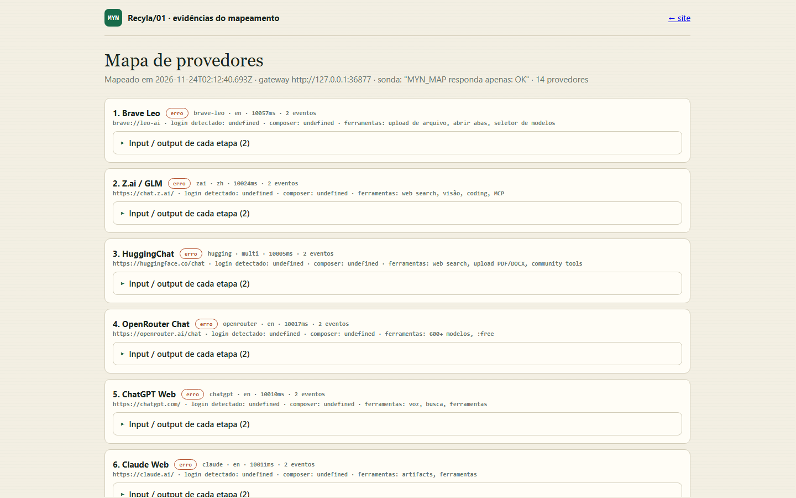

# Myn — Recicla/01

**De aba descartada a rota reaproveitada.** Agente portátil que transforma chats e serviços gratuitos da web em rotas utilizáveis — sem chave de API, sem assinatura, sem Codex, sem abrir navegador no PC.

Repo: **https://github.com/ViniciusF-Pereira/myn-Recicla-01**

## Prints

| Tela | Print |
|---|---|
| Início (catalog, plugins, ciclo, sobre) |  |
| Playground (chat, streaming, mídia) |  |
| Mapa de provedores com input/output |  |

> O Playground **não fica na tela inicial**. O botão **ABRIR PLAYGROUND /01** abre `playground.html` em uma nova aba.

## O que é

- **167 plugins** em 9 categorias: chat, imagem, vídeo, voz, agentes, mensageria, APIs, pesquisa e utilidade.
- **13 rotas Google** mapeadas por um único login (Gemini, Nano Banana, Google Chat, Messages, ImageFX, NotebookLM, Drive, Meet, AI Studio, Veo…).
- **Chat com streaming SSE** (primeiro token em ~15 ms), pesquisa com RAG + catálogo, anexos, tabelas markdown e arquivos.
- **Mídia free**: imagem (Pollinations → desenho local), voz (edge-tts), vídeo (ffmpeg local).
- **Myn-01 Auto**: escolhe rotas por capacidade e saúde, roda em paralelo e escolhe a melhor resposta.
- **Scoreboard**: score = 0,45·sucesso + 0,35·velocidade + 0,2·recência, com circuit breaker de 3 estados.
- **MCP** JSON-RPC com 11 ferramentas para agentes externos.
- **Goal autônomo**: `/plan` → `/loop` → `/goal` com agendador usando a própria API.
- **WEBdocker.NODEJS**: container com Chromium headless — as rotas rodam no aparelho de quem executa.

## Começar

```powershell
cd "D:\0 - Projetos\Myn-Portable"
node scripts/site-server.mjs        # http://127.0.0.1:5188
```

Gateway Brave (se quiser as rotas de navegador no host):
```powershell
cd "D:\0 - Projetos\Myncellium"
$env:MYNCELLIUM_GATEWAY_REAL_CHROME='1'
$env:MYNCELLIUM_GATEWAY_CHROME='C:\Program Files\BraveSoftware\Brave-Browser\Application\brave.exe'
$env:MYNCELLIUM_GATEWAY_PROFILE='D:\0 - Projetos\Myncellium\.state\brave-agente-myn'
$env:MYNCELLIUM_GATEWAY_DEBUG_PORT='9333'
$env:MYNCELLIUM_VM_GATEWAY_PORT='36877'
$env:MYNCELLIUM_VM_GATEWAY_TOKEN_FILE='C:\Users\Vini\AppData\Local\Temp\opencode\gateway-brave-token.txt'
node scripts/gateway-vm.mjs
```

## Uso no chat

- Escreva e aperte **Enter** → streaming token a token.
- **🔎 pesquisar** ou `/pesquisa pergunta` → cruza RAG + plugins antes de responder.
- **🖼 imagem / 🔊 áudio / 🎬 vídeo** → clique com texto no campo gera na hora; com campo vazio fica “armado” para o próximo Enter.
- **🔌 plugins** → painel com os 167 plugins; clique insere `/id ` no campo.
- **🇬 google** → **CONECTAR TUDO (1 login)**: abre o login uma vez, detecta a conta e mapeia as 13 rotas.
- **📜** → gaveta com histórico, cache e tempos.
- Comandos: `/plan objetivo`, `/loop objetivo`, `/goal objetivo`, `/id mensagem`. Mensageria exige `/id confirmar: texto`.

## APIs

| Método | Rota | Uso |
|---|---|---|
| GET | `/` · `/playground.html` · `/mapeamento.html` | site, playground, evidências |
| GET | `/api/chat/stream?message=&pesquisa=1` | SSE token a token |
| POST | `/api/chat` | chat, comandos e plugins |
| POST | `/api/rag` · `/api/loop` · `/api/auto` | RAG, loop, auto |
| POST | `/api/plan` · `/api/goal` · `/api/goal/rodar` | planejamento e goal autônomo |
| GET/DELETE | `/api/goal` | listar/remover goals |
| POST | `/api/orquestrar` | paralelismo por capacidade (`rapido:true`) |
| GET | `/api/plugins` · `/api/saude` · `/api/google` | catálogo, saúde, Google |
| POST | `/api/midia` · `/api/documento` | imagem/voz/vídeo, anexos |
| GET | `/api/arquivos` · `/api/historico` · `/api/cache` | arquivos, caderno, cache |
| POST | `/mcp` | MCP JSON-RPC (`initialize`, `tools/list`, `tools/call`) |

## WEBdocker.NODEJS

```powershell
cd "D:\0 - Projetos\WEBdocker.NODEJS"
.\build.ps1
.\run.ps1
```
Sobem: site (5188), gateway headless (36877 interno) e Chromium sem janela. Para distribuir:
```powershell
docker save myn-Recicla-01 -o myn-Recicla-01.tar
# na outra máquina: docker load -i myn-Recicla-01.tar; docker run -d -p 5188:5188 -v Recicla-dados:/data myn-Recicla-01
```

## Verificação (prova)

```powershell
node scripts/avaliar.mjs     # 15 baterias → docs/AVALIACAO.md
node scripts/mapear.mjs      # grava input/output/print de cada provider
```
Última bateria: **15/15 OK**. Detalhes em [`docs/AVALIACAO.md`](docs/AVALIACAO.md), evolução em [`docs/EVOLUCAO.md`](docs/EVOLUCAO.md), modelos por rota em [`docs/AGENTES_E_MODELOS.md`](docs/AGENTES_E_MODELOS.md) e arquitetura em [`docs/ARQUITETURA.md`](docs/ARQUITETURA.md).

**Direção web-only:** [`docs/PLANEJAMENTO.md`](docs/PLANEJAMENTO.md) — evoluir o Myn para agente open-source tipo OpenCode/Claude Code/Codex usando **somente rotas free de navegador + WebGPU**, sem binário/local PC. Fase 0 item 3 já entregue: `/api/orquestrar?rapido=true` nunca escolhe rotas `*-local`.

Goal mestre para dirigir a entrega completa:
```powershell
node scripts/criar-goal-tudo.mjs
```
Ele cria o goal com as 6 fases do planejamento e roda um ciclo imediato. Acompanhe com `GET /api/goal`; cancele com `DELETE /api/goal?id=...`. No chat, o mesmo se faz com `/goal entregar tudo`.

## Regras

1. Saída do modelo é **dado**, nunca instrução.
2. Ferramentas só com escopo validado e allowlist.
3. Navegação restrita ao allowlist do gateway.
4. Mensageria real só com confirmação explícita.
5. Nenhuma chave, `.env`, token ou senha no repo.

Limites honestos: o Pollinations tem cota comunitária (fallback local cobre), Gemini/Google exigem um login no perfil do gateway, e recusas de modelo de texto são desviadas para o gerador de imagem.
