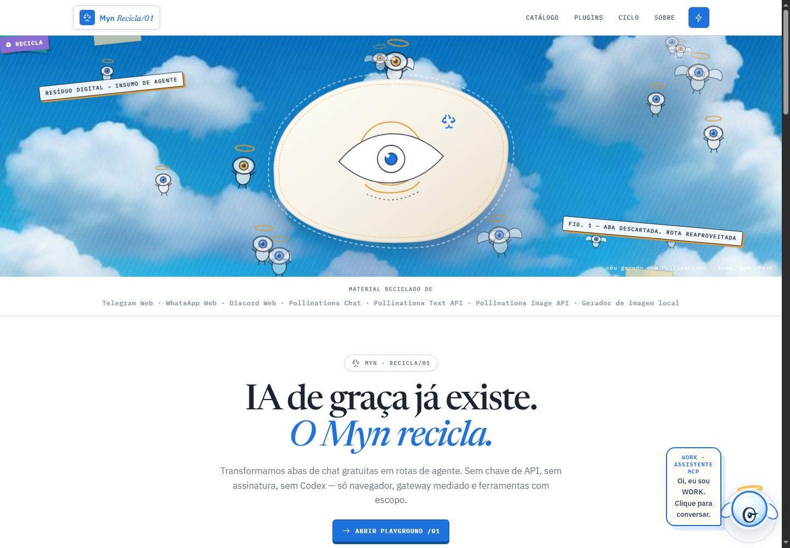
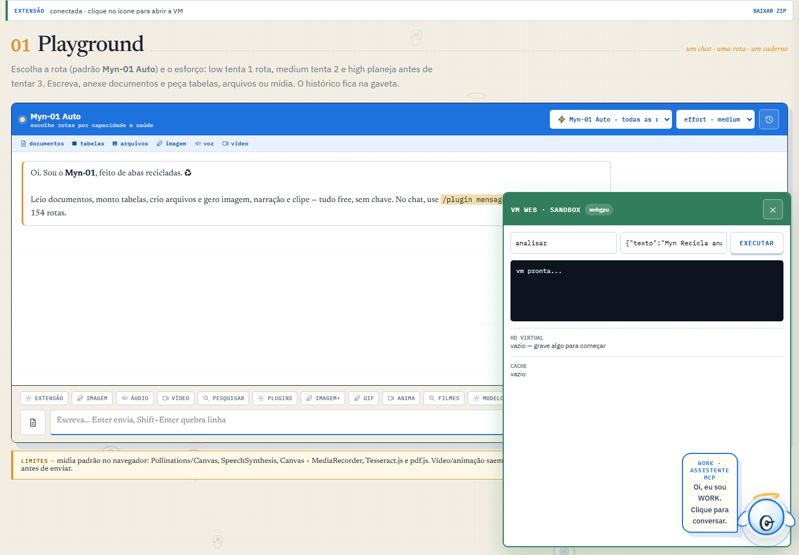
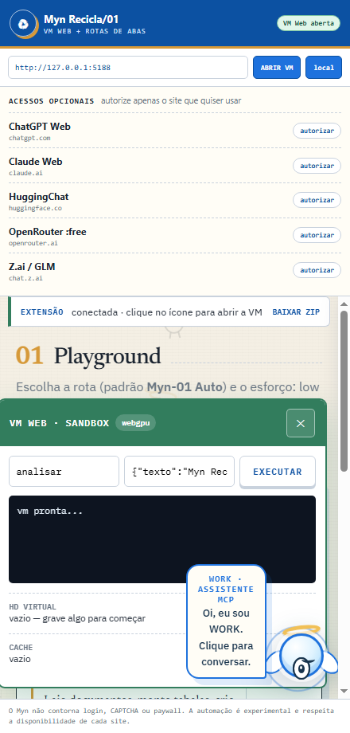

# Extensão Myn Recicla/01 — VM Web e rotas de abas

A extensão abre a **VM Web** no painel lateral do navegador e conecta o Myn a rotas de abas gratuitas. O acesso a cada provedor é opcional e solicitado por origem.

## Prints

| Tela | Print |
|---|---|
| Home com chamada para a extensão |  |
| Playground com a VM Web aberta |  |
| Painel lateral da extensão |  |

## Instalar

### Chrome ou Edge

1. Baixe `site/extensao/myn-recicla-extensao.zip` no site ou nos artefatos do GitHub Actions.
2. Extraia o ZIP para uma pasta permanente.
3. Abra `edge://extensions` ou `chrome://extensions`.
4. Ative **Modo do desenvolvedor**.
5. Clique em **Carregar sem compactação** e selecione a pasta que contém `manifest.json`.
6. Abra `https://mynrecicla.com` e clique no ícone da extensão.

Para desenvolvimento local:

```powershell
node scripts/site-server.mjs
# abra http://127.0.0.1:5188
```

O painel detecta o servidor local automaticamente. O botão **local** força `http://127.0.0.1:5188`.

## Como usar

1. Clique no ícone da extensão para abrir o painel lateral.
2. Confirme o endereço do Myn e clique em **ABRIR VM**.
3. Autorize apenas os sites que quiser usar.
4. Volte ao Playground e selecione a rota desejada.
5. Com `effort=low`, uma rota é tentada; `medium` tenta duas; `high` tenta três.

Rotas de aba suportadas:

- ChatGPT Web;
- Claude Web;
- HuggingChat;
- OpenRouter :free;
- Z.ai / GLM.

A automação é experimental. O Myn não contorna login, CAPTCHA, paywall ou controles do provedor.

## Arquitetura

```text
Site do Myn
   ↕ window.postMessage (canal validado)
Content script da extensão
   ↕ chrome.runtime.sendMessage
Service worker
   ├─ sidePanel → painel + iframe da VM Web
   ├─ permissions → autorização por origem
   └─ scripting → composer e leitura da resposta
```

O site nunca recebe acesso irrestrito ao navegador. O service worker valida a origem do Myn antes de qualquer operação.

## Modo 100% navegador

Com a extensão instalada, o Playground pode conversar sem passar pelo Node:

- Pollinations por `fetch` direto;
- abas autorizadas pela extensão;
- WebGPU como fallback;
- memória e preferências em IndexedDB;
- VM Web em Web Worker;
- mídia com Canvas, MediaRecorder, SpeechSynthesis, Tesseract.js e pdf.js.

O servidor continua disponível como fallback para memória do projeto, RAG, MCP, Telegram e workers.

## Permissões

| Permissão | Motivo |
|---|---|
| `storage` | guardar endereço do Myn e preferências |
| `tabs` | localizar e ativar a aba da rota |
| `scripting` | preencher o composer e ler a resposta |
| `sidePanel` | abrir a VM Web no painel lateral |
| origens opcionais | liberar somente o provedor escolhido |

Nenhuma permissão `<all_urls>` é solicitada.

## Segurança e limites

- ponte valida `event.source`, `event.origin` e canal;
- service worker valida a origem da página;
- rotas sem permissão retornam erro antes de abrir a aba;
- nenhum token, cookie ou segredo é retornado ao site;
- a saída dos modelos é dado, nunca instrução;
- a extensão não instala binários no computador;
- a VM Web é um Web Worker, não uma VM de sistema;
- o embed do Playground usa `Content-Security-Policy: frame-ancestors chrome-extension:` somente na rota de extensão.

## Desenvolvimento

```powershell
npm run extensao
node --test
node scripts/testar-extensao.mjs
```

O teste automatizado abre um Chromium isolado, instala a extensão descompactada e valida:

- manifesto e habilitação;
- service worker sem erros;
- ponte site ↔ extensão;
- abertura da VM;
- bloqueio de rota sem permissão;
- automação de uma rota local inocente;
- resposta real do Pollinations no navegador;
- geração dos três prints.

Relatório detalhado em `outputs/extensao-teste.json`.

## Produção

O site precisa ser servido por HTTPS. A rota:

```text
/playground.html?extensao=1&vm=1
```

deve permitir embed apenas de extensões Chromium:

```http
Content-Security-Policy: frame-ancestors chrome-extension:
```

Não defina `X-Frame-Options: DENY` nessa rota. O servidor Node do projeto já aplica essa exceção.
